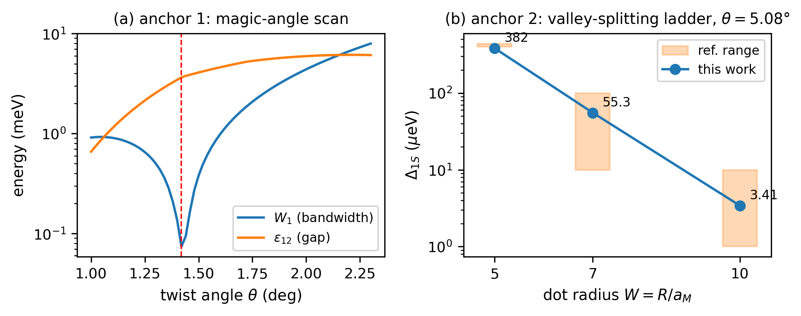
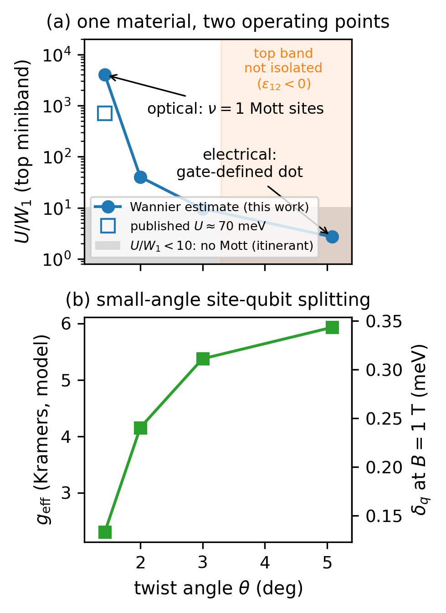
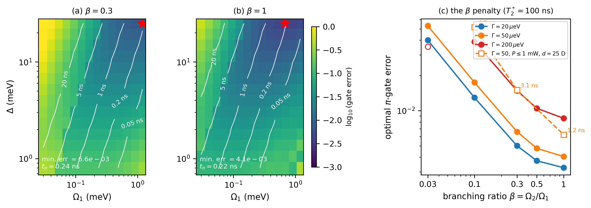
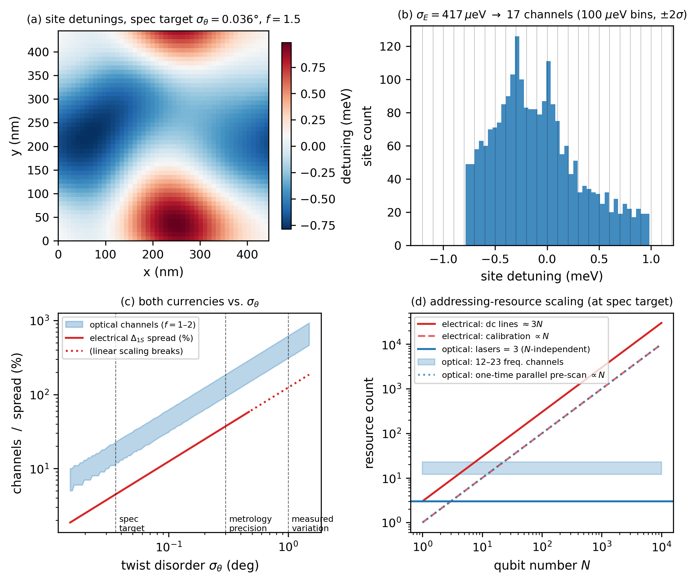

# Electrical versus optical control of valley qubits in twisted WSe₂

**A same-material comparison on a doubly anchored numerical pipeline**

**Status:** Manuscript in preparation (unpublished). The extended abstract is in `paper/ABSTRACT.md`. All Raman-gate numbers here are from the corrected budget (after a sign error in the AC-Stark term was found and fixed in an internal audit; earlier versions of these numbers are superseded).

## Question

Twisted WSe₂ offers two competing routes to valley qubits: a **gate-defined moiré quantum dot** whose 1S valley doublet is split and driven electrically [Saleem *et al.*, arXiv:2608.05229], and an **optically addressed** alternative assembled from established ingredients — spin–valley Kramers qubits on the sites of the ν = 1 moiré Mott insulator. How do the two control paradigms compare quantitatively in the same material?

## Method

- Single continuum-model pipeline (plane-wave moiré Hamiltonian, Devakul–Fu parametrization) for bulk bands, gate-defined dots and Mott-site levels.
- Two independent anchors of one shared parametrization: the magic angle, and the published gate-dot valley-splitting ladder.
- Three-level Lindblad budget (QuTiP) for the optical π gate: two-laser Raman via the moiré-trapped intralayer trion, scanned over the branching ratio β; laser power tied to the trion transition dipole via its radiative lifetime.
- Monte Carlo of twist-angle disorder as an explicit axis for both architectures.
- Supporting DFT registry calculations (Quantum ESPRESSO) for parameter cross-checks (`dft/fit_params.py`).

## Key results

- **Validation.** Predicted magic angle 1.42° vs. published 1.43°. The solver reproduces the reported exponential valley-splitting ladder: Δ₁S(W = 5/7/10) = 382 / 55.3 / 3.41 µeV against the published "hundreds / tens / a few" µeV; fitted mass 0.483 mₑ vs. 0.50 mₑ; **14/14 checks pass**.
- **The comparison is not angle-symmetric.** The Mott parameter collapses from U/W₁ ~ 10²–10³ at 1.43° to 2.7 at 5.08°, so each paradigm owns a different twist angle of the same crystal.
- **Optical π gate (corrected Raman budget).** With β = 1 the gate reaches 0.22 ns at 4×10⁻³ error; β = 0.3 is nearly as good (0.24 ns, 7×10⁻³); the error climbs to ≳ 2×10⁻² at β ≤ 0.1. Counting non-radiative trion decay as leakage raises these errors by up to a factor of 2.
- **Laser power is a binding constraint.** For trion lifetimes of 10 ps – 1 ns (d ≈ 25–350 D) the fastest working points need 0.02–11 mW per site; at the weak-dipole end a 1-mW cap reintroduces a β penalty (β = 1: 1.2 ns, 6×10⁻³; β = 0.3: 3.1 ns, 1.5×10⁻²).
- **β is the enabling technology.** Spin–valley locking leaves no closed Λ system at B ∥ z. A Voigt field alone cannot supply β (β ≲ 4×10⁻³ even at 30 T against the 0.46-eV spin–orbit splitting), leaving strain and gate-induced valley hybridization as the candidate routes.
- **Twist disorder.** At a specification target σθ = 0.036° it costs the electrical architecture a 4.5% spread of Δ₁S (per-site calibration) and the optical one ~17 frequency channels. At the disorder actually measured in tWSe₂ (lateral twist variations > 1° over micrometres) both budgets fail: twist homogeneity is a shared prerequisite.
- **Verdict.** Electrical control wins on maturity and disorder robustness today and matches the optical gate in speed without a laser-power budget. Optical control wins wiring scaling at N ≳ 10²–10³ qubits only *if* β, single-shot readout and σθ ≲ 0.05° are all solved and the trion lifetime is short enough to keep the per-gate laser power in the mW class.






*Figs. 1–4: pipeline validation; the two twist-angle regimes; corrected Raman π-gate budget vs. β; twist-disorder scaling of both architectures.*

## Negative and limiting results

- Neither side's T₂ is measured or reliably computable; this deliberately omitted number bounds what can be claimed.
- Only twist disorder is modeled; charged impurities, strain and dielectric inhomogeneity add independently and would affect the optical channel count more than the individually trimmed electrical dots.
- A gate electrode 3–20 nm above the array imprints a potential wider than the moiré period, so gate control of the optical array is global or per block, not site-shaped.
- The optical route depends on an unengineered branching ratio and an unmeasured trion lifetime.

## Verification

- Two independent published anchors (magic angle; gate-dot valley ladder, 14/14 checks).
- The Raman budget was re-derived after the audit found the AC-Stark sign error; laser power was added as an explicit constraint, with the transition dipole tied to the radiative lifetime (`scripts/dipol_tutarlilik.py`, `results/dipol_tutarlilik.json`).

## Repository contents

- `scripts/src/` — continuum solver, dot and level models, disorder Monte Carlo, bulk validation.
- `scripts/` — Raman budget and power scans, dipole–lifetime consistency, extra estimates, figure generation.
- `results/` — JSON outputs behind every figure and number.
- `dft/` — DFT parameter-fit script. `paper/ABSTRACT.md` — extended abstract.

Some file names are in Turkish (*dipol tutarlılık* = dipole consistency, *ek tahminler* = additional estimates).

## Reproducing

```
pip install -r scripts/requirements.txt
python scripts/src/validate_bulk.py
python scripts/raman_budget.py
python scripts/raman_power.py
python scripts/fig_uret.py   # paths may need adjusting
```

## Related work by the author

- Twisted hBN moiré artificial atoms: https://doi.org/10.5281/zenodo.24201814
- Twisted MoS₂ hole-spin coherence: https://www.alphaxiv.org/abs/2611.twisted-mos2-hole-spin-coherence
- Moiré microwave loss: https://doi.org/10.5281/zenodo.24204124
- josim-cpr-bridge: https://github.com/FarukSamiBilgin/josim-cpr-bridge

## AI assistance

AI assistance: AI coding assistants were used for code development and for adversarial review. All load-bearing results were re-derived by independent methods and checked by automated tests; the author is responsible for every claim.

## Citation

Faruk Sami Bilgin (Independent Researcher, ORCID [0009-0001-9064-4410](https://orcid.org/0009-0001-9064-4410)), *Electrical versus optical control of valley qubits in twisted WSe₂: a same-material comparison on a doubly anchored numerical pipeline*, manuscript in preparation (2026). See `CITATION.cff`.

License: code MIT (`LICENSE`); text, figures and data CC BY 4.0 (`LICENSE-CONTENT`).
